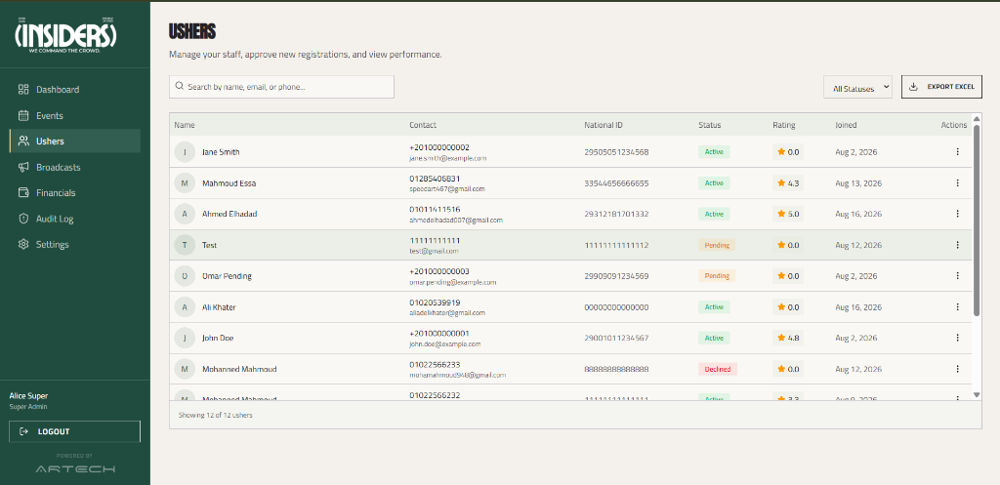
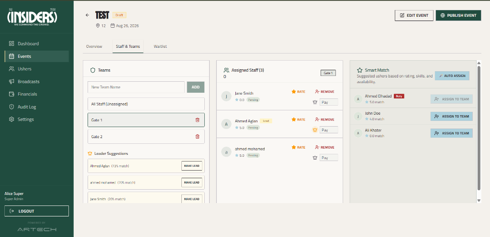
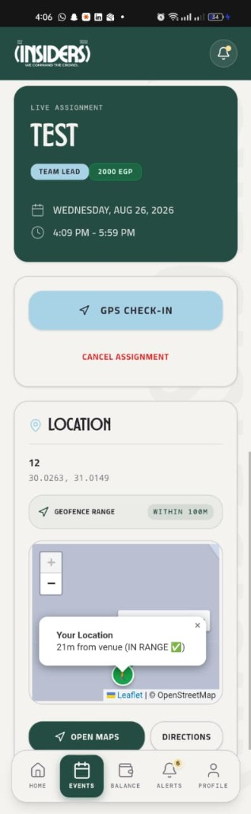
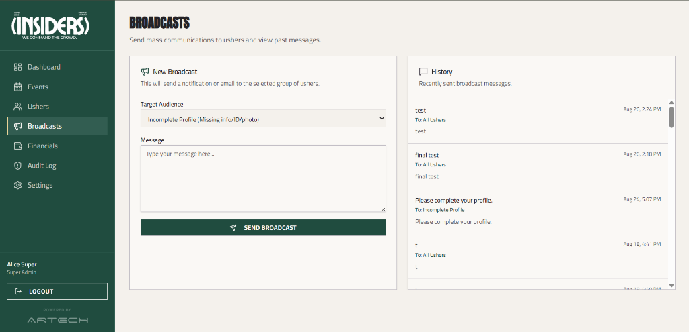
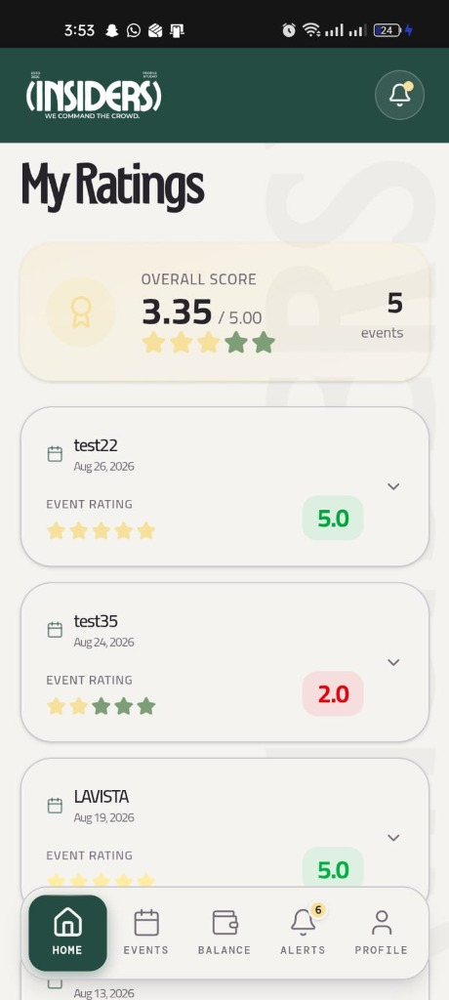
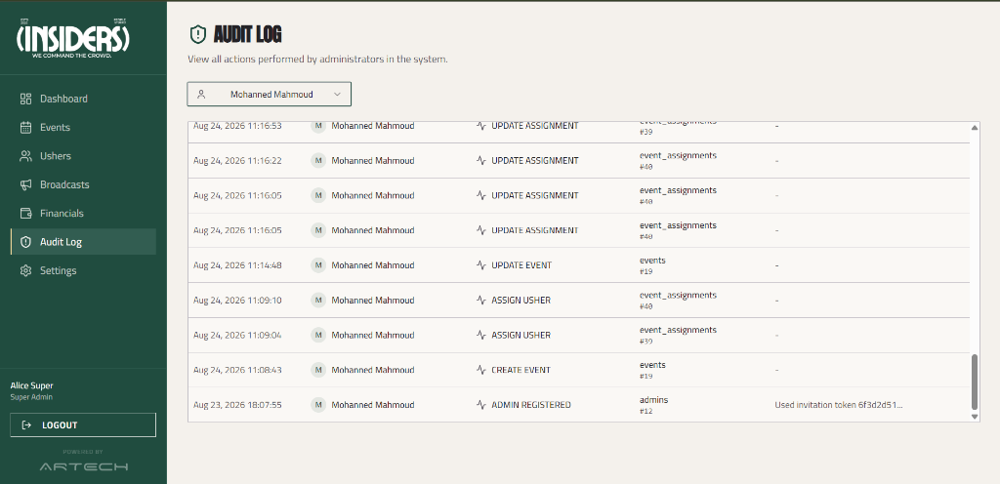
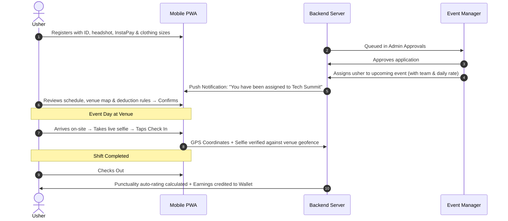
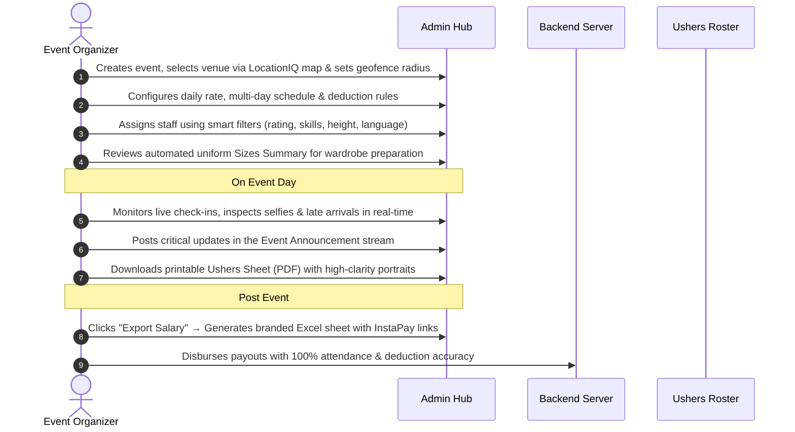

<div align="center">
  <a href="./readme-assets/insiders-logo-white.png" target="_blank">
    
  </a>
  <p align="center">
    <strong>We Command the Crowd</strong><br/>
    The Premier End-to-End Event Staffing, Usher Management & Operations Platform
  </p>
  <p align="center">
    
    
    
    
    
  </p>
</div>

---

## Table of Contents
- [Executive Overview](#executive-overview)
- [The Problem It Solves](#the-problem-it-solves)
- [System Architecture & Ecosystem](#system-architecture--ecosystem)
- [Key Features & Core Modules](#key-features--core-modules)
  - [1. Usher Onboarding, National ID & InstaPay Integration](#1-usher-onboarding-national-id--instapay-integration)
  - [2. Smart Event Staffing, Teams & Waitlists](#2-smart-event-staffing-teams--waitlists)
  - [3. Geofenced Attendance & Live Selfie Photo Verification](#3-geofenced-attendance--live-selfie-photo-verification)
  - [4. Dedicated Event Announcements & Live Chat Stream](#4-dedicated-event-announcements--live-chat-stream)
  - [5. Apparel & Uniform Logistics (Automated Sizes Aggregator)](#5-apparel--uniform-logistics-automated-sizes-aggregator)
  - [6. Smart Deduction Engine & Lateness Matrix](#6-smart-deduction-engine--lateness-matrix)
  - [7. Usher Suspension Engine & Disciplinary Countdown](#7-usher-suspension-engine--disciplinary-countdown)
  - [8. Executive Financial Suite & Branded Excel Payroll Export](#8-executive-financial-suite--branded-excel-payroll-export)
  - [9. High-Definition Printable Ushers Sheet (PDF)](#9-high-definition-printable-ushers-sheet-pdf)
  - [10. Intelligent Bilingual Venue Mapping & Geofencing](#10-intelligent-bilingual-venue-mapping--geofencing)
  - [11. Automated Rating & Punctuality Scoring Engine](#11-automated-rating--punctuality-scoring-engine)
  - [12. Live Admin Command Center & Immutable Audit Log](#12-live-admin-command-center--immutable-audit-log)
- [End-to-End User Journeys](#end-to-end-user-journeys)
  - [The Usher's Experience](#the-ushers-experience)
  - [The Event Organizer's Workflow](#the-event-organizers-workflow)
- [Visual Assets & High-Resolution Screenshot Guide](#visual-assets--high-resolution-screenshot-guide)
  - [Optimizing Tall & High-Resolution Screenshots](#optimizing-tall--high-resolution-screenshots)
  - [Recommended Assets Index](#recommended-assets-index)
- [Branding & Design System](#branding--design-system)

---

## Executive Overview
**INSIDERS** is a full-scale event staffing and crowd operations platform built for premier event agencies, production houses, and staffing organizations. 

Managing hundreds of ushers, supervisors, and guest-experience personnel across multi-day conferences, exhibitions, concerts, and VIP galas requires rigorous coordination. INSIDERS replaces chaotic WhatsApp groups, untracked spreadsheets, and paper sign-in sheets with an automated, synchronized digital command system.

---

## The Problem It Solves

| Traditional Staffing Hassles | The INSIDERS Solution |
| :--- | :--- |
| **Ghost Attendance & Lateness**<br/>Staff claim they arrived on time or have friends sign paper sheets for them. | **Dual-Factor Check-in**<br/>GPS geofencing combined with mandatory live selfie capture at the venue. |
| **Manual Payroll Calculation**<br/>Counting hours, deductions, daily rates, and multi-day shifts in Excel by hand takes days. | **Automated Financial Engine**<br/>Instant salary calculation with deductions, multi-day pay, and 1-click branded Excel sheets with InstaPay links. |
| **Uniform & Sizing Chaos**<br/>Organizers manually message hundreds of ushers to tally T-shirt and pants sizes before ordering uniforms. | **Automated Sizes Aggregator**<br/>Instant headcount of clothing sizes per event on the dashboard and in exported rosters. |
| **Fragmented Communication**<br/>Lost updates in massive group chats, missed announcements, and last-minute shift confusion. | **Dedicated Event Chat & FCM Push**<br/>Per-event announcement channels and urgent broadcast push notifications directly on ushers' mobile devices. |
| **Lack of Disciplinary Recourse**<br/>No-shows and latecomers repeatedly accept shifts without accountability. | **Auto-Rating & Suspension Engine**<br/>Automated punctuality rating deductions, preset disciplinary suspensions, and automated upcoming shift revocations. |

---

## System Architecture & Ecosystem

INSIDERS consists of three deeply integrated applications running on top of a unified PostgreSQL backend:

```
┌────────────────────────────────────────────────────────────────────────┐
│                              INSIDERS                                  │
├───────────────────────────────┬────────────────────────────────────────┤
│ 📱 Ushers Mobile PWA          │ 💻 Admin Operations Hub                │
│ • Progressive Web App         │ • Executive Analytics & Dashboards     │
│ • Offline-ready with SW       │ • Visual Event Builder & Map Geofence │
│ • GPS Geolocation & Camera    │ • Smart Usher Filtering & Allocation  │
│ • FCM Push Notifications      │ • Live Attendance & Selfie Audit       │
│ • Wallet & InstaPay Profile   │ • ExcelJS & jsPDF Exporters            │
└───────────────┬───────────────┴────────────────┬───────────────────────┘
                │                                │
                ▼                                ▼
┌────────────────────────────────────────────────────────────────────────┐
│                        🚀 API & Realtime Server                        │
│ • Node.js / Express REST Engine with OpenAPI Schema Generation         │
│ • Drizzle ORM + PostgreSQL (Neon Database with Connection Pooling)    │
│ • Firebase Cloud Messaging (FCM) Push Service                          │
│ • LocationIQ Geocoding & Custom Venue Discovery Service                │
└────────────────────────────────────────────────────────────────────────┘
```

---

## Key Features & Core Modules

### 1. Usher Onboarding, National ID & InstaPay Integration
Ushers onboard through a structured registration pipeline. Applicants submit:
- Personal details, spoken languages, and physical attributes (height, age, experience).
- Professional headshot and front/back National ID documents.
- **InstaPay Integration:** Automatic extraction and validation of Egyptian InstaPay handles/payment links for zero-friction electronic payouts.
- Account approval queue where administrators inspect submitted credentials before granting platform access.

<div align="center">
  <a href="./readme-assets/account-approval.png" target="_blank" title="Click to view full-resolution screenshot">
    
  </a>
</div>

---

### 2. Smart Event Staffing, Teams & Waitlists
Event managers can schedule single-day or multi-day events with fine-grained staffing controls:
- **Team Structuring:** Organize ushers into operational teams (e.g., VIP Protocol, Main Stage, Gate Registration, Media Logistics).
- **Leadership Roles:** Designate Team Leads with higher daily rates and supervisory responsibilities.
- **Multi-Day Compensation:** Automated calculation of working days and total earnings preview (`dailyRate × workingDays`).
- **Smart Filtering:** Filter the entire database by gender, height, language proficiency, rating, and governorate.
- **Instant Allocation & Waitlists:** One-click assignment with push notification invites. Ushers can accept or decline, with immediate waitlist replacements.

<div align="center">
  <a href="./readme-assets/event-assignment.png" target="_blank" title="Click to view full-resolution screenshot">
    
  </a>
</div>

---

### 3. Geofenced Attendance & Live Selfie Photo Verification
To eliminate fraudulent attendance, INSIDERS enforces dual-factor check-in:
- **GPS Geofence Radius:** The app verifies the usher's precise GPS coordinates against the event venue coordinates (e.g., within 300–500m). Check-in remains disabled outside the radius.
- **Live Selfie Photo:** Ushers must take and submit a live photo in uniform upon arrival.
- **Admin Check-in Details Modal:** Admins can click any checked-in usher to view their arrival timestamp, exact minutes late (if any), GPS location accuracy, and submitted selfie photo.

<div align="center">
  <a href="./readme-assets/checkin-screen.png" target="_blank" title="Click to view full-resolution screenshot">
    
  </a>
  <p><sub>📱 Mobile View: Click image to expand in full native resolution</sub></p>
</div>

---

### 4. Dedicated Event Announcements & Live Chat Stream
Smooth operations depend on real-time field communication:
- **In-Event Chat Stream:** Each event has an interactive channel where admins can publish announcements, gate assignments, and schedule modifications.
- **Push Notification Integration:** Urgent messages trigger native mobile push notifications to all assigned ushers via Firebase Cloud Messaging.
- **Mobile-Optimized Viewer:** Clean, responsive chat interface designed specifically for ushers on the move.

<div align="center">
  <a href="./readme-assets/broadcasts-screen.png" target="_blank" title="Click to view full-resolution screenshot">
    
  </a>
</div>

---

### 5. Apparel & Uniform Logistics (Automated Sizes Aggregator)
Uniform distribution is one of the most tedious aspects of event preparation. INSIDERS automates the entire supply chain:
- **Comprehensive Size Profiles:** Ushers maintain clothing measurements in their profile (T-Shirt/Top, Jacket, Pants with numerical sizing 28–44, and Shoe sizes).
- **Real-Time Sizes Summary:** The event details page aggregates the uniform requirements of all assigned staff into an instant tally.
- **Roster Export Integration:** The uniform breakdown is automatically embedded into exported PDF sheets for warehouse and wardrobe teams.

---

### 6. Smart Deduction Engine & Lateness Matrix
Admins have granular control over punctuality and attendance policies:
- **Configurable Deduction Rules:** Set specific grace periods and monetary deductions per event (e.g., 15–30 mins late = EGP 50 deduction, 30–60 mins late = EGP 100 deduction).
- **Upfront Policy Transparency:** Deduction rules appear as highlighted warning badges on event cards in the Ushers App before staff confirm attendance.
- **Automated Execution:** Deductions are automatically calculated at checkout and reflected in financial sheets without manual math.

---

### 7. Usher Suspension Engine & Disciplinary Countdown
Reliability is reinforced through a multi-tiered disciplinary system:
- **Preset & Custom Suspension Durations:** Admins can suspend unreliable staff for preset durations (3 days, 7 days, 14 days, 30 days) or select a custom date.
- **Automated Default Sanctions:** The platform supports default penalty suspension days for severe violations or no-shows.
- **Live Suspension Countdown:** Suspended ushers see a dedicated suspension screen in their mobile app with an active countdown timer.
- **Automatic Shift Revocation:** Suspending an usher automatically revokes their upcoming event assignments and frees slots for waitlisted staff.

---

### 8. Executive Financial Suite & Branded Excel Payroll Export
Seamless financial oversight with one-click payroll generation:
- **Digital Wallets:** Every completed shift credits the usher's ledger (net of deductions and bonuses).
- **Executive Excel Export (ExcelJS):** Generates a formatted, publication-ready Excel spreadsheet styled in the Insiders Navy & Teal brand palette.
- **Attendance Whitelisting:** Automatically filters out cancelled, declined, or no-show applicants, including only ushers who actually checked in.
- **Payroll Breakdown:** Distinguishes supervisors from regular ushers, calculates total working days, gross pay, deductions, net totals, and embeds clickable InstaPay links for batch disbursements.

---

### 9. High-Definition Printable Ushers Sheet (PDF)
A dedicated on-site operational sheet generated dynamically:
- **Enlarged High-Clarity Photos:** Enlarged usher portraits for quick visual identification at security checkpoints and supervisor desks.
- **Operational Data:** Full name, assigned operational role/team, and dedicated signature/notes column for physical roll calls.
- **Uniform Sizes Matrix:** Embedded summary of all clothing sizes on the subsequent page for equipment handover.
- **Print & Mobile Friendly:** Rendered using high-DPI HTML canvas and jsPDF with Arabic typography support.

---

### 10. Intelligent Bilingual Venue Mapping & Geofencing
Pinpoint venue setup powered by an integrated mapping engine:
- **LocationIQ Integration:** Instant autocomplete search supporting English and Arabic venue names across Egypt and the Middle East.
- **Custom Saved Places:** Admins can bookmark frequent venues (halls, stadiums, exhibition centres) with pre-calibrated coordinates and radii.
- **Interactive Leaflet Map:** Draggable pins, dynamic radius circles, and real-time geofence visualization.

---

### 11. Automated Rating & Punctuality Scoring Engine
A continuous feedback loop that rewards top performers:
- **Auto-Rating Algorithm:** Computes an objective punctuality score based on exact check-in minutes relative to call time.
- **Admin & Client Reviews:** Manual reviews combined with the auto-score to form a 5-star weighted rating.
- **Merit-Based Allocation:** High-rated ushers are prioritized in search results and automated invitations.

<div align="center">
  <a href="./readme-assets/ratings-feedback.png" target="_blank" title="Click to view full-resolution screenshot">
    
  </a>
</div>

---

### 12. Live Admin Command Center & Immutable Audit Log
Complete operational transparency for executive teams:
- **Live Command Dashboard:** High-level metrics tracking active events, confirmed staff, check-in completion rates, and budget utilization.
- **Immutable Audit Trail:** Every critical management action—application approval, salary adjustment, manual check-in override, or suspension—is logged with admin timestamps and IP origins.

<div align="center">
  <a href="./readme-assets/admin-dashboard.png" target="_blank" title="Click to view full-resolution screenshot">
    
  </a>
</div>

<br/>

<div align="center">
  <a href="./readme-assets/audit-log.png" target="_blank" title="Click to view full-resolution screenshot">
    
  </a>
</div>

---

## End-to-End User Journeys

### The Usher's Experience


### The Event Organizer's Workflow


---

## Visual Assets & High-Resolution Screenshot Guide

### Optimizing Tall & High-Resolution Screenshots

When capturing tall (portrait/vertical 9:16 mobile) screenshots or full-height dashboard scrolls, follow these rules to maintain **100% original visual fidelity**:

1. **Lossless Format (PNG Only):** Always save screenshots in **PNG format** (`.png`). Never save as `.jpg` or `.jpeg` (JPEG produces color banding, fuzzy text, and compression noise on dark UI).
2. **Native Retina Resolution:**
   - **For Mobile Screens:** Capture at your device's native resolution (e.g. 1080×2400 or 1170×2532). When placed in the README with `width="320"` to `width="360"`, the image renders at crisp **3× Retina pixel density**.
   - **For Desktop Dashboards:** Capture at 1920×1080 or higher (DPR 2×).
3. **Prevent Transfer Compression:** When transferring screenshots from your phone to PC, **do not use WhatsApp or Facebook Messenger** (they compress images by 70%+). Use **Telegram (Send as File/Uncompressed)**, Google Drive, AirDrop, or a direct USB cable.
4. **Click-to-Expand Full Quality:** Every screenshot in this README is wrapped in an anchor link (`<a href="./readme-assets/...png" target="_blank">`). Clicking any screenshot on GitHub opens the unscaled, 100% raw high-resolution image in full quality.

---

### Recommended Assets Index

| # | Feature / Screenshot Name | Application & Route | What to Capture | Target Filename | Recommended Width |
|---|:---|:---|:---|:---|:---:|
| **1** | **Admin Command Dashboard** | Admin Hub (`/dashboard`) | High-level metrics, active events, staff attendance stats, and quick actions. | `admin-dashboard.png` | `820px` (Wide) |
| **2** | **Event Details & Attendance** | Admin Hub (`/events/:id`) | Event header, team assignments, check-in badges, and action buttons. | `event-details.png` | `820px` (Wide) |
| **3** | **Check-in Verification Modal** | Admin Hub (`/events/:id` → Click Usher) | Modal showing arrival time, late minutes, GPS accuracy, and live selfie photo. | `checkin-details-modal.png` | `550px` (Modal) |
| **4** | **Event Announcements & Chat** | Admin Hub (`/events/:id` tab) or PWA | Dedicated event chat stream with announcements and messages. | `event-chat.png` | `750px` (Desktop) / `340px` (Mobile) |
| **5** | **Uniform Sizes Aggregator** | Admin Hub (`/events/:id`) | The "Sizes Summary" card displaying aggregated T-shirt, pants, and shoe counts. | `sizes-summary.png` | `600px` (Card) |
| **6** | **Deduction Rules Tab** | Admin Hub (`/events/:id` → Deductions) | Multi-tier lateness and absence deduction rules configuration table. | `deduction-rules.png` | `750px` (Table) |
| **7** | **Usher Suspension Dialog** | Admin Hub (`/ushers/:id` → Suspend) | Suspension modal with preset buttons (3d, 7d, 14d, 30d, custom date picker). | `suspension-dialog.png` | `500px` (Modal) |
| **8** | **Printable Ushers Sheet (PDF)** | Exported PDF Preview | Rendered PDF showing enlarged usher photos, teams, signature lines, and sizes. | `ushers-sheet-pdf.png` | `750px` (Document) |
| **9** | **Branded Excel Salary Sheet** | Microsoft Excel Preview | Navy & Teal styled Excel sheet showing supervisors, rates, deductions, and InstaPay links. | `salary-sheet-excel.png` | `820px` (Spreadsheet) |
| **10** | **Venue Geofencing & Map** | Admin Hub (`/events/new`) | Leaflet map with LocationIQ search, draggable pin, and geofence radius circle. | `map-geofence.png` | `750px` (Map) |
| **11** | **Usher Profile & Apparel** | Ushers App (`/profile`) | Profile view with clothing sizes (T-Shirt, Pants 28-44, Shoes) and InstaPay handle. | `usher-profile-sizes.png` | `340px` (Tall Mobile) |
| **12** | **Mobile Check-in & Selfie** | Ushers App (`/events/:id`) | Check-in view with live GPS status button and selfie camera capture. | `usher-checkin-selfie.png` | `340px` (Tall Mobile) |
| **13** | **Suspended Usher View** | Ushers App (`/events`) | Dedicated suspension alert screen showing the live countdown timer. | `usher-suspension-timer.png` | `340px` (Tall Mobile) |

---

## Branding & Design System

INSIDERS follows a visual philosophy of **Authority, Professionalism, and Clean Elegance**:
- **Monochrome & Deep Navy Canvas:** Sleek high-contrast dark interface accented with Navy (`#00003087`) and Electric Teal (`#0070C0`).
- **Typography:** Modern, legible sans-serif hierarchy tailored for rapid scanning under intense event conditions.
- **Micro-Interactions:** Subtle status badges, smooth drawer transitions, and responsive feedback indicators across both mobile PWA and desktop panels.

<div align="center">
  <a href="./readme-assets/branding-overview.png" target="_blank" title="Click to view full-resolution screenshot">
    
  </a>
</div>

---

<div align="center">
  <sub>Designed and engineered for high-performance event operations. © INSIDERS. All rights reserved.</sub>
</div>
